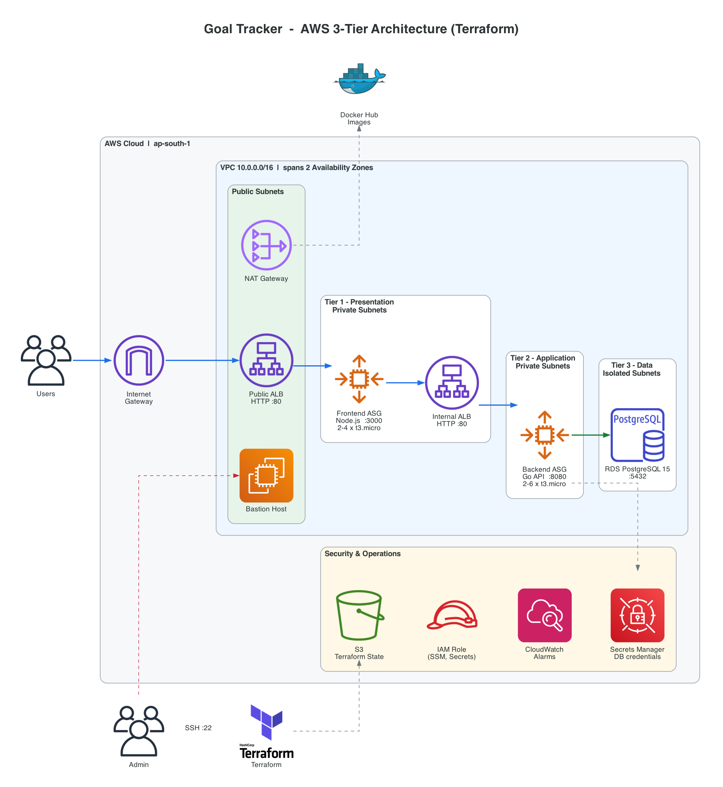

<div align="center">

# Goal Tracker on AWS: 3-Tier Architecture with Terraform

**A highly available, secure, and fully automated three-tier web application on AWS, provisioned end to end with modular Terraform.**

[](https://www.terraform.io/)
[](https://aws.amazon.com/)
[](https://registry.terraform.io/providers/hashicorp/aws/latest)
[](https://www.docker.com/)
[](https://go.dev/)
[](https://nodejs.org/)
[](https://www.postgresql.org/)

</div>

---

## Table of Contents

- [Architecture Overview](#architecture-overview)
- [Architecture Diagram](#architecture-diagram)
- [Tech Stack](#tech-stack)
- [Features](#features)
- [Prerequisites](#prerequisites)
- [Project Structure](#project-structure)
- [How to Deploy](#how-to-deploy)
- [Configuration](#configuration)
- [Cleanup](#cleanup)
- [Future Improvements](#future-improvements)
- [Author](#author)

---

## Architecture Overview

The application is split into three isolated tiers. Each tier runs in its own set of subnets across **two Availability Zones** and is reachable only from the tier directly in front of it.

| Tier | Component | Runs in | Reachable from |
|------|-----------|---------|----------------|
| **Presentation** | Node.js / Express frontend in Docker on an EC2 Auto Scaling Group | Private frontend subnets | Public ALB only (port 3000) |
| **Application** | Go (Gin) REST API in Docker on an EC2 Auto Scaling Group | Private backend subnets | Internal ALB only (port 8080) |
| **Data** | Amazon RDS for PostgreSQL 15 | Isolated database subnets | Backend security group only (port 5432) |

**Request flow**

1. A user's request enters through the **Internet Gateway** and reaches the **public Application Load Balancer**.
2. The public ALB forwards traffic to healthy **frontend** instances on port 3000.
3. The frontend calls the API through an **internal ALB**, which is not reachable from the internet.
4. The internal ALB routes to healthy **backend** instances on port 8080.
5. The backend reads its database credentials from **AWS Secrets Manager** at boot and connects to **RDS PostgreSQL** over SSL.

Private instances reach the internet (to pull container images and OS packages) through a **NAT Gateway**. Administrators connect through a **bastion host** that accepts SSH only from a single allowed IP, or through **AWS Systems Manager Session Manager**, with no open ports.

---

## Architecture Diagram

<p align="center">
  
</p>

> The diagram is generated from code with official AWS icons. To regenerate it, run `python docs/architecture.py` (requires Graphviz and the `diagrams` package).

---

## Tech Stack

| Category | Tools |
|----------|-------|
| **Infrastructure as Code** | Terraform (>= 1.13), HashiCorp AWS provider (~> 6.0), Random provider (~> 3.7) |
| **Cloud Provider** | AWS (`ap-south-1`) |
| **Networking** | VPC, public/private/isolated subnets, Internet Gateway, NAT Gateway, route tables |
| **Compute** | EC2 (Ubuntu 22.04 LTS), Launch Templates, Auto Scaling Groups |
| **Load Balancing** | Application Load Balancers (public and internal) |
| **Database** | Amazon RDS for PostgreSQL 15 |
| **Security** | Security Groups, IAM roles and instance profiles, AWS Secrets Manager, SSM Session Manager |
| **Observability** | Amazon CloudWatch alarms, CloudWatch Agent |
| **State Management** | Amazon S3 remote backend with native state locking |
| **Containers** | Docker multi-stage builds, distroless runtime images, Docker Hub |
| **Application** | Go 1.23 (Gin), Node.js 18 (Express) |

---

## Features

**Infrastructure**
- Fully modular Terraform: 9 reusable modules (`vpc`, `security-groups`, `iam`, `alb`, `bastion`, `frontend-asg`, `backend-asg`, `rds`, `secrets`)
- Multi-AZ VPC with four subnet layers: public, frontend, backend, and database
- Public ALB for user traffic and an internal ALB for service-to-service traffic
- Auto Scaling Groups with ELB health checks and CPU target-tracking policies (70%)
- Remote state in a versioned, encrypted S3 bucket with native lock files
- Separate bootstrap configuration for the state backend

**Security**
- Application and database tiers have no public IPs
- Security groups chained tier to tier (ALB → frontend → internal ALB → backend → RDS)
- Database credentials generated by Terraform and stored in Secrets Manager, never hardcoded
- Encrypted EBS volumes and RDS storage
- IMDSv2 enforced on all instances
- Bastion SSH restricted to a single CIDR, plus SSM Session Manager access

**Operations**
- Zero-touch instance bootstrapping through user-data scripts
- CloudWatch alarms for high CPU and unhealthy hosts
- Docker log rotation and container health checks on backend instances
- Script to build and push images for `linux/amd64` and trigger rolling instance refreshes
- Docker Compose setup for running the full stack locally

---

## Prerequisites

| Requirement | Notes |
|-------------|-------|
| AWS account | With permissions to create VPC, EC2, ELB, RDS, IAM, S3, and Secrets Manager resources |
| [AWS CLI v2](https://docs.aws.amazon.com/cli/latest/userguide/getting-started-install.html) | Configured with `aws configure` |
| [Terraform](https://developer.hashicorp.com/terraform/install) | Version 1.13 or later |
| [Docker](https://docs.docker.com/get-docker/) | With Buildx (included in Docker Desktop) |
| [Docker Hub](https://hub.docker.com/) account | For hosting the application images |
| EC2 key pair | Created in the deployment region |

---

## Project Structure

```text
3-tier-architecture-aws-terraform/
├── backend/                        # Go REST API
│   ├── Dockerfile                  # Multi-stage build -> distroless image
│   ├── go.mod / go.sum
│   └── main.go
├── frontend/                       # Node.js / Express web server
│   ├── Dockerfile                  # Multi-stage build -> distroless image
│   ├── package.json
│   ├── public/index.html
│   └── server.js
├── docker-local-deployment/        # Run the full stack locally
│   ├── docker-compose.yml
│   └── database/init.sql
├── docs/
│   ├── architecture.png            # Architecture diagram
│   └── architecture.py             # Diagram source (diagrams-as-code)
└── terraform-infra/
    ├── bootstrap/                  # Creates the S3 remote-state bucket (run once)
    │   └── main.tf
    ├── env/
    │   └── dev/                    # Dev environment root module
    │       ├── main.tf
    │       ├── outputs.tf
    │       ├── providers.tf        # Provider and S3 backend configuration
    │       └── variables.tf
    ├── modules/
    │   ├── alb/                    # Public and internal load balancers
    │   ├── backend-asg/            # Launch template + ASG for the API tier
    │   ├── bastion/                # Bastion host with Elastic IP
    │   ├── frontend-asg/           # Launch template + ASG for the web tier
    │   ├── iam/                    # EC2 role: SSM, CloudWatch, Secrets Manager
    │   ├── rds/                    # PostgreSQL instance, subnet and parameter groups
    │   ├── secrets/                # Secrets Manager secret for DB credentials
    │   ├── security-groups/        # Tier-to-tier security groups
    │   └── vpc/                    # VPC, subnets, IGW, NAT, route tables
    └── scripts/
        ├── backend_user_data.sh    # Backend instance bootstrap
        ├── frontend_user_data.sh   # Frontend instance bootstrap
        ├── build-and-push.sh       # Build amd64 images and push to Docker Hub
        └── deploy.sh               # Guided deployment helper
```

---

## How to Deploy

### 1. Clone the repository

```bash
git clone https://github.com/trupti-vibhute/3-tier-architecture-aws-terraform.git
cd 3-tier-architecture-aws-terraform
```

### 2. Create the remote state bucket (one time)

```bash
cd terraform-infra/bootstrap
terraform init
terraform apply
```

This creates a versioned, encrypted, private S3 bucket named `goal-tracker-tfstate-<account-id>`. Make sure the `bucket` value in `terraform-infra/env/dev/providers.tf` matches the `state_bucket_name` output.

### 3. Create an EC2 key pair

```bash
aws ec2 create-key-pair --region ap-south-1 --key-name goal-tracker-dev \
  --key-type rsa --key-format pem --query KeyMaterial --output text > ~/.ssh/goal-tracker-dev.pem
chmod 400 ~/.ssh/goal-tracker-dev.pem
```

### 4. Build and push the container images

```bash
docker login
./terraform-infra/scripts/build-and-push.sh <your-dockerhub-username>
```

Images are built for `linux/amd64` so they run on x86 EC2 instances, including when built on Apple Silicon.

### 5. Configure variables

Create `terraform-infra/env/dev/terraform.tfvars`:

```hcl
region           = "ap-south-1"
ssh_key_name     = "goal-tracker-dev"
allowed_ssh_cidr = "203.0.113.10/32"   # your public IP: curl -s https://checkip.amazonaws.com

frontend_docker_image = "<your-dockerhub-username>/goal-tracker-frontend:latest"
backend_docker_image  = "<your-dockerhub-username>/goal-tracker-backend:latest"
```

### 6. Deploy the infrastructure

```bash
cd terraform-infra/env/dev
terraform init
terraform plan -out=tfplan
terraform apply tfplan
```

Provisioning takes about 15 minutes, mostly for RDS and the NAT Gateway.

### 7. Access the application

```bash
terraform output application_url
```

Open the URL in a browser. Instances need a few minutes after `apply` to boot, pull images, and pass health checks.

### 8. Roll out new images (optional)

Instances pull images only at boot. After pushing new images, replace the instances with a rolling refresh:

```bash
aws autoscaling start-instance-refresh --region ap-south-1 --auto-scaling-group-name dev-goal-tracker-frontend-asg
aws autoscaling start-instance-refresh --region ap-south-1 --auto-scaling-group-name dev-goal-tracker-backend-asg
```

### Administrative access

```bash
# SSH through the bastion host
ssh -i ~/.ssh/goal-tracker-dev.pem ubuntu@$(terraform output -raw bastion_public_ip)

# Or use SSM Session Manager (no SSH keys or open ports needed)
aws ssm start-session --region ap-south-1 --target <instance-id>
```

### Run locally (optional)

```bash
cd docker-local-deployment
docker compose up --build
# http://localhost:3000
```

---

## Configuration

Key variables in `terraform-infra/env/dev/variables.tf`:

| Variable | Description | Default |
|----------|-------------|---------|
| `region` | AWS region | `ap-south-1` |
| `project` / `environment` | Used in resource names and tags | `goal-tracker` / `dev` |
| `vpc_cidr` | VPC address range | `10.0.0.0/16` |
| `availability_zones` | AZs for subnet placement | `ap-south-1a`, `ap-south-1b` |
| `single_nat_gateway` | One shared NAT Gateway (lower cost) instead of one per AZ | `true` |
| `ssh_key_name` | EC2 key pair name | **required** |
| `allowed_ssh_cidr` | CIDR allowed to SSH to the bastion | `0.0.0.0/0` (override this) |
| `frontend_instance_type` / `backend_instance_type` | EC2 instance types | `t3.micro` |
| `frontend_min_size` / `frontend_max_size` | Frontend ASG bounds | `2` / `4` |
| `backend_min_size` / `backend_max_size` | Backend ASG bounds | `2` / `6` |
| `db_instance_class` | RDS instance class | `db.t3.micro` |
| `db_engine_version` | PostgreSQL version | set to one available in your region |
| `db_multi_az` | Multi-AZ RDS deployment | `false` |
| `db_backup_retention` | Backup retention in days (AWS free plan max: 1) | `7` |
| `frontend_docker_image` / `backend_docker_image` | Container images to deploy | Docker Hub images |
| `dockerhub_username` / `dockerhub_password` | Only needed for private images | empty |

> `terraform.tfvars` is excluded by `.gitignore`. Never commit credentials or state files.

**Free-tier note:** AWS free-plan accounts reject `t2.micro` in some regions and RDS backup retention above 1 day. Use `t3.micro` and `db_backup_retention = 1` on those accounts.

---

## Cleanup

Destroy all application infrastructure to stop charges:

```bash
cd terraform-infra/env/dev
terraform destroy
```

This permanently deletes the database and its data.

The state bucket created in `bootstrap/` has `prevent_destroy` enabled and is kept on purpose. To remove it as well, empty the bucket (including all object versions), remove the `prevent_destroy` lifecycle block, then run `terraform destroy` in `terraform-infra/bootstrap`.

**Cost awareness:** the NAT Gateway, both ALBs, RDS, and the EC2 instances bill hourly. Destroy the environment when it isn't in use.

---

## Future Improvements

- **HTTPS:** ACM certificate on the public ALB with an HTTP-to-HTTPS redirect, plus a Route 53 custom domain
- **CI/CD:** GitHub Actions pipeline for `terraform fmt`, `validate`, `plan` on pull requests, and image builds on merge
- **Container registry:** move from Docker Hub to Amazon ECR with image scanning
- **Least privilege:** scope the Secrets Manager IAM policy to the exact secret ARN
- **Secret delivery:** stop passing registry credentials through user data
- **High availability:** Multi-AZ RDS and one NAT Gateway per AZ for production
- **Environments:** add `staging` and `prod` roots that reuse the same modules
- **Security scanning:** `tfsec` / `checkov` in CI, plus AWS WAF on the public ALB
- **Observability:** CloudWatch dashboards and SNS notifications for alarm actions
- **Orchestration:** evaluate migrating the app tiers to Amazon ECS on Fargate

---

## Author

**Trupti Vibhute** | Cloud & DevOps

[](https://github.com/trupti-vibhute)

If you found this project useful, consider giving it a star.
